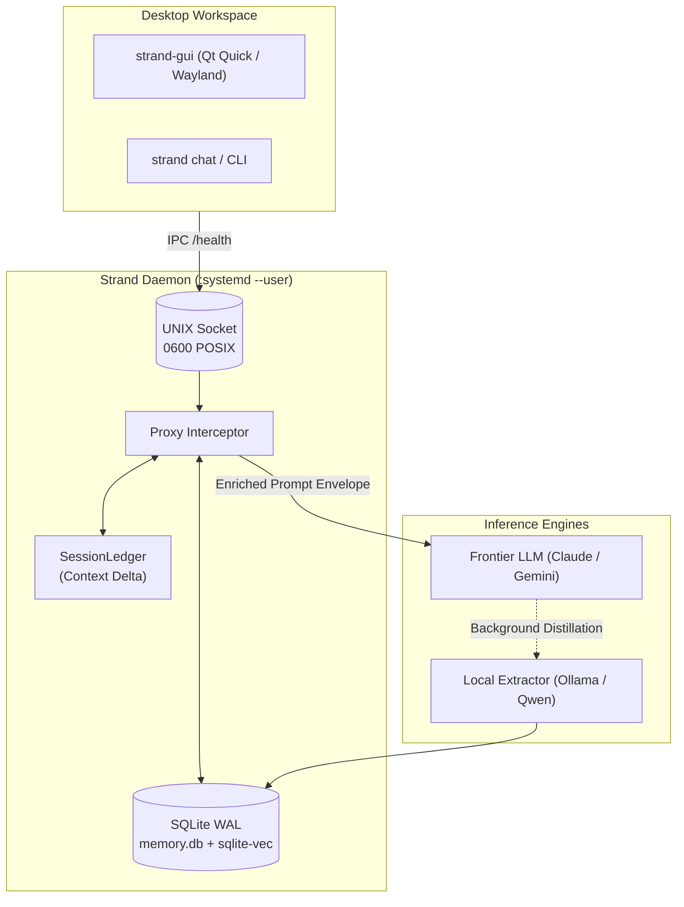

# Strand

[](LICENSE)
[](https://www.python.org/downloads/)
[](#)
[-success)](#)

A quiet, local memory service for your LLM tools on Linux.

## What is Strand?

Strand is a background service for Linux. It runs on your machine and sits between your chat tools (terminal, editor, the bundled GUI) and an LLM. It intercepts `/v1/chat/completions` requests over a local UNIX socket, looks up what it already knows about you and your work in SQLite (with vector search), adds only the relevant new context to the prompt, and forwards the request. The LLM gets persistent working memory, and you don't have to repeat yourself.

## Why it exists

- **Saves tokens.** Only the relevant, not-yet-sent context is added to each prompt.
- **Keeps context across sessions.** Projects, hardware, people and preferences are remembered between sessions, tools and models.
- **Keeps your data on your machine.** Memory lives in one local SQLite file you own. Nothing leaves your machine except the chat request you make.

## Key features

- **Systemd user daemon** (`Type=notify`). It starts with your session and needs no root.
- **Local UNIX domain socket** at `$XDG_RUNTIME_DIR/strand/strand.sock` (directory `0700`, socket `0600`). Loopback TCP at `127.0.0.1:8088` is the fallback.
- **KDE/Wayland GUI companion** (`strand-gui`) with keyboard shortcuts.
- **No external database server.** SQLite in WAL mode plus [`sqlite-vec`](https://github.com/asg017/sqlite-vec). Memory is stored as entities, edges and episodes. No Docker.
- **Fail-closed privacy.** Entities marked private are never injected unless a request explicitly opts in with `X-Strand-Allow-Private`. Corrupt metadata is treated as private. No telemetry.

## Architecture Overview



## Quickstart

### Prerequisites

- Linux with a `systemd --user` session
- Python 3.11 or newer
- `pipx` (`dnf install pipx`, `apt install pipx` or `pacman -S python-pipx`)
- Optional: [Ollama](https://ollama.com) for a local model

### Install

```bash
./scripts/install.sh --editable    # editable install, good for development
# or
pipx install .
```

Running `./scripts/install.sh` without `--editable` does a regular pipx install. The script also sets up the desktop entry, icon, systemd user service and embedding model, then runs `strand doctor`. It refuses to run as root and is safe to re-run. Without systemd, run the daemon in the foreground with `strand daemon --diag`.

### Use

```bash
strand doctor    # check the install, service, socket and database
strand chat      # interactive terminal chat
strand-gui       # desktop chat window
```

In `strand chat`: `/help`, `/new`, `/private on|off`, `/stats`, `exit`. `Ctrl+C` aborts the current reply. In `strand-gui`: `Ctrl+L` new session, `Ctrl+D` diagnostics, `Esc` abort.

Maintenance commands that work directly on the database (the daemon need not be running): `strand stats | list | inspect | drop | prune-stale | prune-decayed | embed-backfill | compact | config | logs`.

### Uninstall

```bash
./scripts/uninstall.sh           # removes the service, package, desktop entry and icon; keeps memory.db
./scripts/uninstall.sh --purge   # also deletes ~/.config/strand, ~/.local/share/strand and ~/.cache/strand (wipes memory.db)
```

## Documentation

- [ARCHITECTURE.md](ARCHITECTURE.md): schema, modules, security rules.
- [CONSTRAINTS.md](CONSTRAINTS.md): what Strand will not do.
- [ROADMAP.md](ROADMAP.md): what is shipped and what is next.

## Development

```bash
pip install -e . pytest
QT_QPA_PLATFORM=offscreen pytest -W error
```

## Colophon

Strand was designed and built together by zuubux and a few AI partners, working as peers. It is released under the [MIT License](LICENSE).
